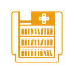
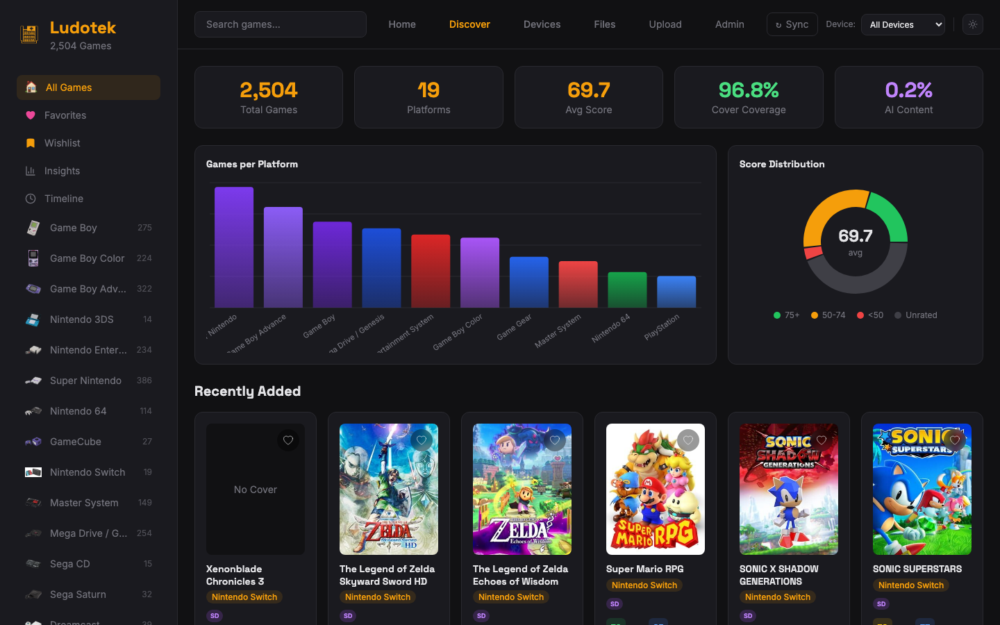
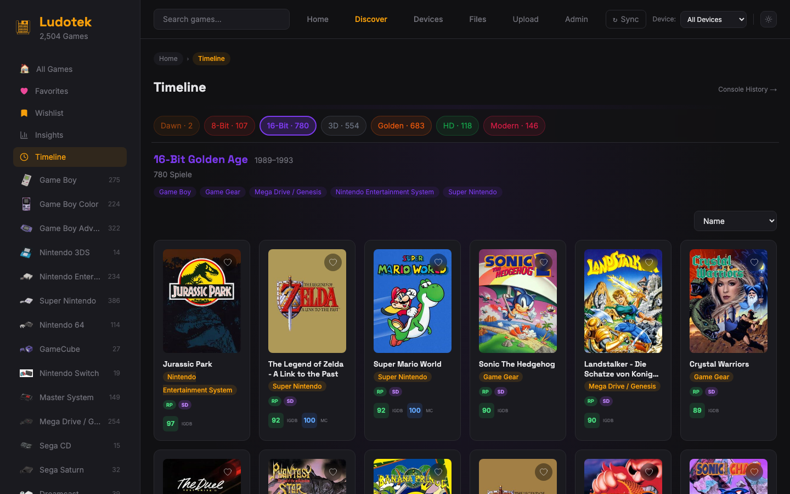
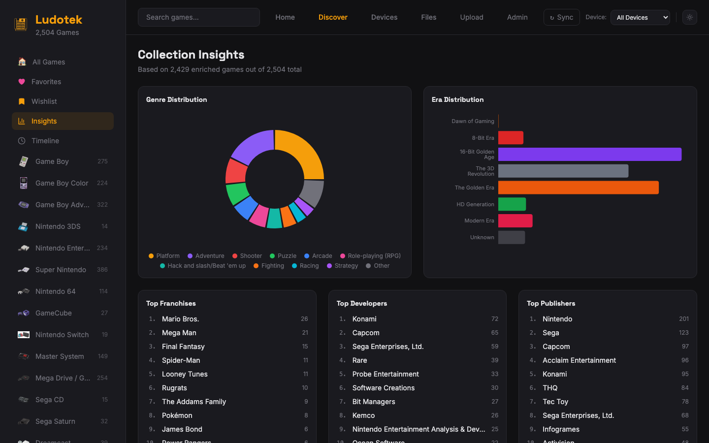
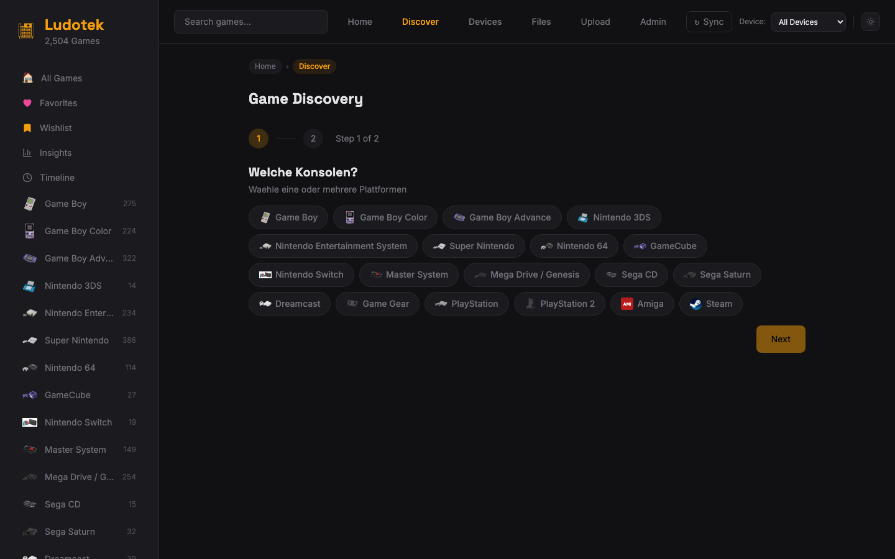
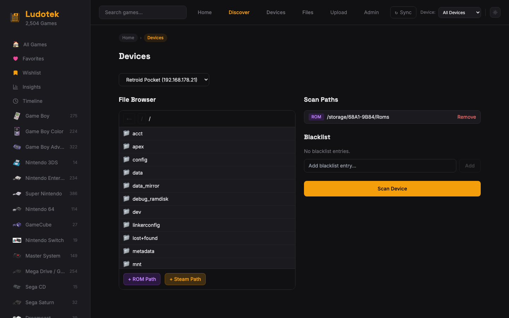

<div align="center">
  
  <h1>Ludotek</h1>
  <p><strong>Your personal retro game library — scan, enrich, browse.</strong></p>
  <p>
    Ludotek scans your devices for ROMs, enriches them with metadata from IGDB,
    and gives you a beautiful library to explore your collection.
  </p>

  <p>
    
    
    
    
    
    
  </p>
</div>

---



<details>
<summary><strong>More Screenshots</strong></summary>

#### Timeline


#### Insights


#### Discover


#### Devices


</details>

## Features

### Device Scanning

Connect to your Steam Deck, Retroid Pocket, or any device via **SSH, FTP, or local filesystem**. Ludotek auto-detects ROMs across **66 platforms** — from Atari 2600 to Nintendo Switch. It recursively scans directories, handles subdirectory layouts (like ES-DE's `xbox/roms/`), cleans filenames, and deduplicates multi-disc games automatically.

### IGDB Enrichment

One click fetches **covers, ratings, release dates, genres, developers, publishers, summaries, screenshots, artwork, and YouTube trailers** from IGDB for your entire collection. Sequential processing respects rate limits with automatic retry on failures. Missing covers fall back to SteamGridDB. All images are cached locally.

### AI-Powered Fun Facts & Stories

Ludotek generates **Fun Facts** (trivia bullet points) and **Story & Background** (narrative about development and legacy) for each game using AI via OpenRouter. Content is rendered as styled markdown on the game detail page, with a refresh button to regenerate individual games. Supports English and German.

### Discover & Recommendations

An AI-powered recommendation engine. Pick your platforms and interests, and Ludotek analyzes your library to suggest games you already own that match, plus missing gems to add to your wishlist. Each recommendation includes a reason why it was picked, expandable details with artwork and trailers, and one-click "Add to Wishlist".

### Timeline

Browse your collection by **gaming era** — from the Dawn of Gaming through 8-Bit, 16-Bit Golden Age, 3D Revolution, and into the Modern Era. Each era shows game counts, platform breakdowns, and a color-coded grid. Includes a Console History page with historical write-ups for every platform in your collection.

### Insights & Analytics

Visual dashboard with **genre distribution** (donut chart), **era distribution** (bar chart), **top franchises, developers, and publishers** (ranked lists), and cross-platform game detection. All charts adapt to your light/dark theme.

### File Manager

Dual-pane file browser for managing ROMs across devices. Browse, transfer (copy or move), rename, and delete files between any two connected devices. Real-time transfer progress with filename, file count, and percentage. Create folders, preview files, and navigate with breadcrumbs.

### ROM Upload

Upload ROMs directly from your browser. **Smart mode** auto-detects platforms from folder structure; **manual mode** lets you pick. A 4-stage pipeline handles format conversion, transfer to device, scanning, and IGDB enrichment — all with real-time per-file progress streaming.

### Sync Queue

Stage rename and delete operations against confirmed physical files and review their stored plans in the Sync Panel. The shared journal verifies source identities, hashes and target collisions, preserves original files in quarantine, and records each filesystem step before updating the catalog. Filesystem and SQLite changes are separate: interrupted work requires explicit recovery, and changed foreign files cause a visible conflict. Applied plans offer Undo; retries reuse the recorded plan.

### Device Diagnostics, Integrity and Profiles

The Devices page provides an explicit Sync Doctor inventory, DAT import and streaming checksum jobs, and editable Steam Deck/Retroid/Miyoo/Custom profiles. Doctor reports distinguish incomplete observations from confirmed missing files. Integrity checks compare every supplied checksum and size; absent DAT matches remain unknown unless you explicitly selected an expected revision. ROM sync supports push, pull and two-way previews with per-file conflict choices and verified successful baselines. Descriptor copies rewrite CUE/GDI/M3U references to actual destination paths.

### Save Versions

Declare save roots in a device profile, inspect its save files, then start a backup. Immutable content objects and version records live in the protected application data directory. Restore and save sync use the same file journal and first preserve any existing target in a verified, persisted backup. Removing a catalog game or device does not delete its versions; the **Save-Versionen** navigation entry shows the global paginated history.

### LAN Discovery

Admin Settings offers an explicitly started scan of a selected private local interface. It probes only SSH/FTP ports with bounded hosts, time and concurrency; there are no credential attempts or automatic device creation. Selecting a result prefills the existing device form. Oversized subnets, including ordinary IPv6 /64 sweeps, are visibly unavailable.

File jobs share an authoritative SQLite namespace and sorted device leases, including overlapping LOCAL roots. LOCAL and supported Linux/OpenSSH SFTP writers require evidenced native identity, exclusive staging, no-replace publication and file/directory flush. Missing required SSH capabilities stop writes; read-only copy sources do not require write capabilities. Destination parent directories must already exist. Concurrent native edits outside Ludotek remain distinct from application leases; detected changes stop recovery, and the narrow native check/unlink race cannot be excluded by Node's path API.

Normal FTP/FTPS uses an explicitly weaker checked policy: bounded transfer, hash verification, server acknowledgement, quarantine and Undo assuming no concurrent external writer. FTP does not provide portable atomic no-replace, native fsync or durable identity; identical foreign replacements cannot be distinguished. Lost/unrecorded public effects remain recovery conflicts. Free space stays unknown and transfers require profile reserve0. The preview shows these limits before Apply. See [protocol and release notes](docs/release-2.0.0-rc.3.md).

### Wishlist

Track games you want to find. Add from Discover recommendations or manually, with configurable ROM search links to find them online. Persistent across sessions.

### Search & Favorites

Global search with live suggestions (debounced, 200ms). Favorite any game with a heart toggle — filter your library to favorites only.

### Setup Wizard

Guided first-run setup in 5 steps: add a device, configure scan paths via file browser, enter API keys, and trigger your first scan. No config files to edit.

### Dark & Light Theme

System-aware theme with manual toggle (sun/moon icon in the header). Warm Stone light palette, classic dark palette. Persisted in localStorage, no flash on page load.

### Security

Device passwords and API keys are encrypted at rest with **AES-256-GCM**. Keys auto-generated on first run, configurable via `ENCRYPTION_KEY` env var. Production and LAN use require an admin token. Tokenless development is restricted to the explicit loopback launcher.

### Docker Ready

One-command deployment with persistent volumes for database and image cache.

## Quick Start

### Docker

Ludotek is a private, locally hosted Open Source app. Build an image from this repository and use a private env file containing a random `ADMIN_TOKEN` and `APP_ORIGIN=http://localhost:3000`. Keep that file outside version control. For example:

```bash
docker build -t ludotek:local .
docker run --rm --name ludotek --env-file ./ludotek.env \
  -p 127.0.0.1:3000:3000 \
  --mount type=volume,source=ludotek-db,target=/app/db \
  --mount type=volume,source=ludotek-data,target=/app/data \
  ludotek:local
```

Open [http://localhost:3000](http://localhost:3000) and sign in with the token before setup. The runner uses UID/GID 1000 rather than root. Existing bind mounts must be writable by that user; review and back up their contents before changing permissions. Persist both volumes, including `data/.encryption-key`, to retain the database and decrypt stored credentials. Container startup applies the additive database migrations.

Existing installations must follow [the database and volume upgrade guide](docs/upgrading-local.md) before changing images. A populated database previously initialized with `db push` needs a verified baseline; migration errors stop startup and never trigger a database reset.

For your own LAN, publish to a specific private host address, keep `ADMIN_TOKEN` set and configure `APP_ORIGIN` to the exact browser origin (scheme and port included). HTTPS origins set a Secure cookie; explicitly configured HTTP LAN origins use an HttpOnly, SameSite=Strict cookie without Secure. Do not expose this installation directly to the public Internet. A separate public hosting/proxy contract is required for that use.

### Manual

```bash
git clone https://github.com/Codevena/ludotek.git
cd ludotek
corepack enable
corepack prepare pnpm@11.21.0 --activate
pnpm install
cp .env.example .env
pnpm exec prisma migrate deploy
pnpm dev
```

Open [http://localhost:3000](http://localhost:3000). `pnpm dev` enforces a loopback bind when no token is configured, validates the browser authority, and sets the actual port's origin. For another local port, use `pnpm dev --port 3100`. Direct tokenless `next dev` calls fail closed. Production (`pnpm build` followed by `pnpm start`) requires `ADMIN_TOKEN`.

To use your own LAN, set `ADMIN_TOKEN`, explicitly set `APP_ORIGIN` (for example `http://192.168.1.20:3000`) and start with `pnpm dev --hostname 192.168.1.20` or the corresponding `pnpm start` command. Bearer API clients may call protected mutations without an Origin; browser cookie mutations require the configured Origin. Forwarded headers never authorize a caller.

Local filesystem devices also require an operator-configured `LOCAL_FILES_ROOT=/absolute/path/to/roms`, or `LOCAL_FILES_ROOTS='["/absolute/path/one","/absolute/path/two"]'`. The browser offers those roots as a virtual selection. The OS root, app internals, database and encryption key cannot be configured as device roots; file operations must stay within a configured root.

### Metadata jobs and provider limits

Bulk, individual, AI, refresh and upload metadata jobs share one SQLite lease. A competing enrichment returns `409` with `Retry-After`; optional upload enrichment is visibly skipped while a successful transfer is preserved. Each batch selects at most 500 games. The UI drains each batch and advances its cursor automatically (at most 100 batches per action), including past entries whose metadata is unavailable. API callers continue with `?afterId=<nextCursor>` only when `hasMore` is true; `pending` counts eligible later IDs and `remaining` counts globally unfinished metadata. Stops preserve actual progress and display their reason. `AI_CONCURRENCY` accepts 1–4 and runs at most two simultaneous AI calls.

Every actual HTTP attempt, including a retry, reserves these persistent operator limits:

| Provider | Rolling short rate | Per hour | Per day | Concurrent requests |
|----------|--------------------|----------|---------|---------------------|
| IGDB | 4/second | 5,000 | 30,000 | 4 |
| Twitch token | 10/minute | 100 | 500 | 4 |
| SteamGridDB | 4/second | 2,000 | 10,000 | 4 |
| OpenRouter | 20/minute | 500 | 2,000 | 2 |
| Image downloads | 20/second | 30,000 | 100,000 | 4 |

Short pressure waits at most 65 seconds with eight waiting requests per provider. Exhausted hourly/daily budgets stop remaining work before dispatch. Requests, including their response bodies, time out after 60 seconds; responses are limited to 4 MiB, images to 20 MiB. These are request caps, not a guaranteed monetary ceiling. Configure spending limits with the provider as well.

Coordination requires all local processes to use the **same SQLite file**. Separate database copies do not provide a distributed lock or shared quota. Store failures reject new work with `503`; no memory-only fallback starts provider calls. Leases expire after crashes, while reserved provider counts survive restarts.

## Configuration

| Variable | Default | Description |
|----------|---------|-------------|
| `DATABASE_URL` | `file:./dev.db` | SQLite database path |
| `ADMIN_TOKEN` | _(empty)_ | Required in production/LAN; tokenless use only through loopback `pnpm dev`. |
| `APP_ORIGIN` | `http://localhost:3000` | Full trusted browser origin; the local launcher sets its actual port. Explicit value required for LAN. |
| `LOCAL_FILES_ROOT` / `LOCAL_FILES_ROOTS` | _(empty)_ | One absolute local device root, or a JSON array of roots. Local filesystem access is disabled when unset. |
| `ENCRYPTION_KEY` | _(auto-generated)_ | AES-256 key for encrypting secrets. Auto-generated to `data/.encryption-key` if not set. |
| `OPENROUTER_MODEL` | `google/gemini-2.5-flash` | AI model for Discover, Fun Facts & Stories |

All other settings (IGDB API keys, SteamGridDB key, devices, scan paths) are configured through the UI after first launch.

Use Node.js 22.13+ or 24 LTS and the pinned pnpm 11.21.0 for local installation. Docker uses Node.js 24. The hook-bound lockfile must be generated and consumed with that same installer. `.pnpmfile.cjs` supplies a restricted default native-build list when no operator policy exists and respects an existing workspace list, including denied builds. Transitive patches keep the deployed dependency graph updated while Prisma stays on 6.x.

## Supported Platforms

66 systems including: Game Boy, GBA, DS, 3DS, NES, SNES, N64, GameCube, Wii, Wii U, Switch, Master System, Mega Drive, Saturn, Dreamcast, Game Gear, PlayStation 1-3, PSP, PS Vita, Xbox, Xbox 360, Atari (2600/5200/7800/Lynx/Jaguar/ST), TurboGrafx-16, Neo Geo, WonderSwan, 3DO, ColecoVision, DOS, Commodore 64, Amiga, MSX, ZX Spectrum, Arcade, PICO-8, ScummVM, and more.

## Contributing

See [CONTRIBUTING.md](CONTRIBUTING.md) for setup instructions and guidelines.

See [docs/architecture.md](docs/architecture.md) for a system overview.

## License

[MIT](LICENSE)
